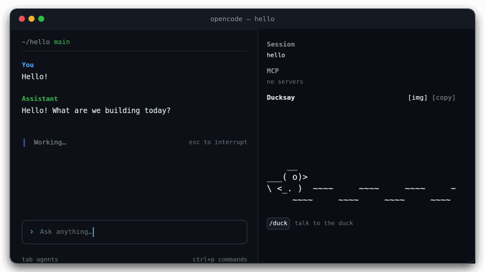

# OpenCode Ducksay

[](https://www.npmjs.com/package/opencode-ducksay)
[](https://github.com/zhek/opencode-ducksay/blob/main/LICENSE)
[](https://opencode.ai/v2/docs/)

A tiny ASCII duck paddles around your OpenCode sidebar and drops funny remarks about your work. It uses your session's model.

[Русская версия](https://github.com/zhek/opencode-ducksay/blob/main/README.ru.md)



## Talk to the duck

Type `/duck <text>` in the TUI to talk to the duck. The dialogue never enters the session's context or transcript.

## Screenshots

Click `[img]` in the `Ducksay` heading, or run `/duck.img`, to save the duck's scene as a PNG. Pictures go to
`.opencode/ducksay/screenshots/` in your project. The folder brings its own `.gitignore`, so they never reach git.

## Choosing a model

The duck jokes with the same model as your session. If that model is paid, you can give the duck a cheaper one:

```json
{
  "plugins": [{ "package": "opencode-ducksay", "options": { "llmModel": "opencode/big-pickle" } }]
}
```

`llmModel` takes a model name in the `"provider/model"` form. Your session keeps its own model. If the model you named is
missing, the duck answers `Quack-quack!` instead of a joke.

## Install

Install the plugin with one command:

```bash
opencode plugin add opencode-ducksay
```

Restart OpenCode.

To enable it in one project only, add `"opencode-ducksay"` to the `plugins` array in that project's `opencode.json`
instead.

## Documentation

- [How the duck behaves](https://github.com/zhek/opencode-ducksay/blob/main/docs/behavior.md) — swimming, jokes,
  questions, talking to the duck and the water.
- [Configuration and options](https://github.com/zhek/opencode-ducksay/blob/main/docs/configuration.md) — `swimSpeed`,
  `silent`, `llmTimeout`, `llmContextDepth`, `llmModel` and the sidebar settings.

## License

[MIT](https://github.com/zhek/opencode-ducksay/blob/main/LICENSE) © Evgeniy Arapov
