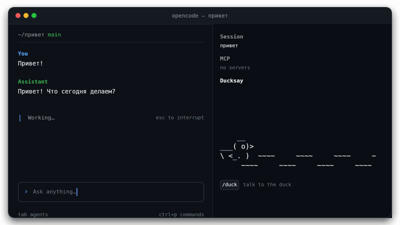

# OpenCode Ducksay

[](https://www.npmjs.com/package/opencode-ducksay)
[](https://github.com/zhek/opencode-ducksay/blob/main/LICENSE)
[](https://opencode.ai/v2/docs/)

Маленькая ASCII-уточка плавает в сайдбаре OpenCode и отпускает забавные комментарии по вашей работе. Уточка использует модель вашей сессии.

[English version](https://github.com/zhek/opencode-ducksay/blob/main/README.md)



## Поговорить с уточкой

Введите `/duck <текст>` в TUI, чтобы поговорить с уточкой. Диалог не попадает в контекст или историю сессии.

## Установка

Установите плагин одной командой:

```bash
opencode plugin add opencode-ducksay
```

Перезапустите OpenCode.

Чтобы включить его только в одном проекте, добавьте `"opencode-ducksay"` в массив `plugins` в `opencode.json` этого
проекта.

## Документация

- [Как ведёт себя уточка](https://github.com/zhek/opencode-ducksay/blob/main/docs/behavior.ru.md) — плавание, шутки,
  вопросы, разговор с уточкой и вода.
- [Конфигурация и опции](https://github.com/zhek/opencode-ducksay/blob/main/docs/configuration.ru.md) — `swimSpeed`,
  `silent`, `llmTimeout`, `llmContextDepth` и настройки боковой панели.

## Лицензия

[MIT](https://github.com/zhek/opencode-ducksay/blob/main/LICENSE) © Evgeniy Arapov
